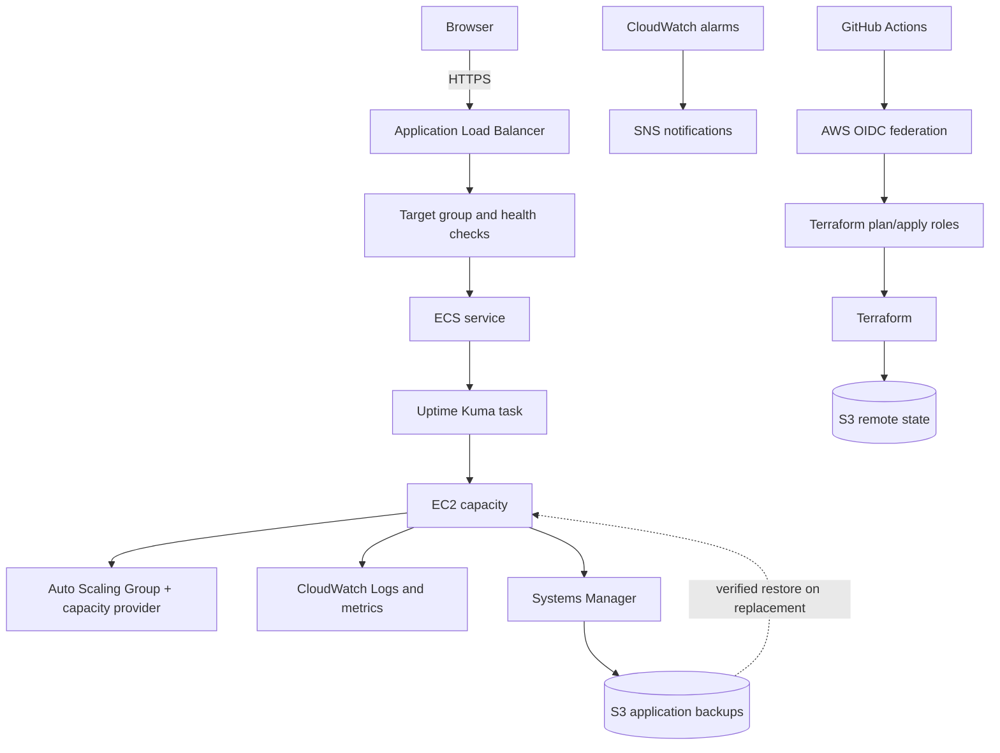

# Uptime Kuma on AWS

**A Terraform-managed, recoverable monitoring stack on Amazon ECS (EC2 capacity).**

I built this project to practise the parts of cloud engineering that sit beyond simply running a container: infrastructure as code, identity federation, capacity management, operational monitoring, backup integrity, and recovery after compute replacement.

<p align="center">
  
  
  
  
</p>

> **Deployment status: test-only.** The application stack is currently torn down. I provision it temporarily when testing and tear it down afterwards, so the public endpoint is normally unavailable.

> **Portfolio highlight — recovery was demonstrated.** I replaced the EC2 host and restored the existing Uptime Kuma monitor configuration and history from S3. The recorded drill showed the dashboard usable approximately **13 minutes 11 seconds after replacement launch**. This is an observed recovery interval, not a formally measured RTO..

## Project at a glance

| Area | Implementation |
| --- | --- |
| Compute and orchestration | ECS service running on EC2 capacity, backed by an Auto Scaling Group and capacity provider |
| Networking | VPC, security groups, Application Load Balancer, HTTPS through ACM |
| Infrastructure as code | Separate Terraform roots for application, state bootstrap, persistent backups, and cost controls |
| Identity and deployment | GitHub Actions OIDC with short-lived AWS credentials and separate plan/apply roles |
| Persistence and recovery | SQLite-consistent backup to S3, SHA-256 verification, SQLite integrity gate, startup restoration |
| Operations | CloudWatch logs, alarms and backup-freshness metric; SNS notifications; Systems Manager without public SSH |
| Security hygiene | Least-privilege IAM intent, restricted host-port ingress, Gitleaks workflow, ignored local state and secrets |

## Architecture



## Engineering highlights

### Recovery, not just deployment

The recovery path is designed to avoid blindly restoring an archive:

1. A Systems Manager job creates a SQLite-consistent application-data snapshot.
2. The archive and SHA-256 sidecar are uploaded to the persistent S3 backup bucket.
3. On replacement, instance startup retrieves the selected backup and verifies its checksum.
4. SQLite integrity is checked before the restored data is made available to the ECS workload.
5. Uptime Kuma returns with the previous monitor configuration and history.

I ran the recovery drill on 16 October 2026. After EC2 replacement, I confirmed that the load-balancer target became healthy and the dashboard returned with its existing monitor data. I did not capture direct checksum output, SQLite integrity output, the exact first-healthy timestamp or the S3 object version ID, so I do not claim an exact RPO or RTO..

### Deployment security

- GitHub Actions authenticates to AWS using OIDC rather than long-lived access keys.
- Planning and applying use separate IAM roles.
- Apply is gated by an explicit confirmation and a protected GitHub Environment.
- The saved Terraform plan is encrypted before being transferred as a short-retention workflow artifact.
- Instance administration uses Systems Manager; there is no public SSH ingress.


### Operational checks

The project includes CloudWatch logging and alarms, SNS email notifications, and a custom backup-freshness metric. I checked the ECS dynamic host-port path on 20 October 2026: container port 3001 mapped to host port 32768, while the host ephemeral range observed was 32768–60999 and the security-group rule permitted TCP 32768–65535.

I have linked previous workflow runs below. They record the successful application deployment, alert wiring, backup-freshness metric fix and Terraform validation. These are historical records, not evidence that the stack is currently running or that I checked the live endpoint today.

| Evidence | Record |
| --- | --- |
| Application deployment | [Workflow run #20](https://github.com/Pedro-Martins9/uptimekuma-aws-deployment/actions/runs/39461906090) |
| SNS/email alarm wiring | [Workflow run #21](https://github.com/Pedro-Martins9/uptimekuma-aws-deployment/actions/runs/39465845112) |
| Backup-freshness metric fix | [Workflow run #22](https://github.com/Pedro-Martins9/uptimekuma-aws-deployment/actions/runs/39473186374) |
| Terraform validation | [Validation run](https://github.com/Pedro-Martins9/uptimekuma-aws-deployment/actions/runs/39472903358) |
| Secret scanning | [Gitleaks workflow](https://github.com/Pedro-Martins9/uptimekuma-aws-deployment/actions/workflows/gitleaks.yml) |

## Design decisions and trade-offs

- **ECS on EC2 instead of Fargate:** this adds responsibility for instance capacity, ECS agent configuration and the capacity provider, but makes the compute/orchestration boundary part of the learning objective.
- **One active task with local SQLite data:** increasing task count would create a persistence/consistency problem rather than automatically improving availability. The deployment therefore uses a deliberately simple single-task model and explicit backup/restore.
- **Separate persistent Terraform roots:** remote state and application backups should survive routine application teardown. The application stack is not responsible for deleting these recovery-critical resources.
- **S3 restore with integrity gates:** an available archive is not enough; checksum and database-integrity checks are part of the startup path.
- **OIDC and Systems Manager:** short-lived federated deployment credentials and managed instance access reduce the need for long-lived keys or inbound administration ports.

## Repository layout

```text
.github/workflows/       CI validation, deployment and secret scanning
terraform/               Main application infrastructure
  bootstrap-state/       One-time remote-state bucket bootstrap
  backup-infra/          Persistent application-backup bucket
  cost-controls/         Optional AWS Budget notifications
  *.tf                   VPC, IAM, ECS, EC2, ALB, monitoring and backup logic
```

## Run it in your own AWS account

This is a multi-root Terraform project, not a one-command deployment. It requires AWS credentials, an existing or bootstrapped remote-state bucket, a persistent application-backup bucket, and an issued ACM certificate in `eu-west-1`.

### Prerequisites

- Terraform `>= 1.12.0, < 2.0.0` (CI currently uses 1.16.5).
- AWS CLI configured for the intended account.
- A DNS name you control and an ACM certificate in `eu-west-1` with status `ISSUED`.
- Permission to create the resources described by the Terraform roots.

Check the AWS identity first. Do not continue unless it is the account you intend to use.

**PowerShell**

```powershell
$accountId = (aws sts get-caller-identity --query Account --output text).Trim()
$env:TF_VAR_aws_account_id = $accountId
$stateBucket = "uptimekuma-tfstate-$accountId"
Copy-Item terraform/terraform.tfvars.example terraform/terraform.tfvars
```

**Bash**

```bash
ACCOUNT_ID="$(aws sts get-caller-identity --query Account --output text)"
export TF_VAR_aws_account_id="$ACCOUNT_ID"
STATE_BUCKET="uptimekuma-tfstate-${ACCOUNT_ID}"
cp terraform/terraform.tfvars.example terraform/terraform.tfvars
```

Edit `terraform/terraform.tfvars` and replace the example AWS account ID, hostname and ACM certificate ARN. This file is ignored by Git. Keep account-specific values and credentials out of tracked files.

### 1. Bootstrap remote state (new accounts only)

Skip this root if the state bucket already exists. Do not initialise the bootstrap root against an existing bucket with empty local state; it will attempt to create resources that may already exist.

```bash
terraform -chdir=terraform/bootstrap-state init
terraform -chdir=terraform/bootstrap-state plan
terraform -chdir=terraform/bootstrap-state apply
```

Preserve its local state securely. The bucket has deletion protection and is intended to persist.

### 2. Create persistent application backup storage

```bash
terraform -chdir=terraform/backup-infra init -backend-config="bucket=${STATE_BUCKET}"
terraform -chdir=terraform/backup-infra plan
terraform -chdir=terraform/backup-infra apply
```

For PowerShell, use `"-backend-config=bucket=$stateBucket"` in the `init` command. The backup bucket is deliberately managed separately from the application stack.

### 3. Deploy the application

```bash
terraform -chdir=terraform init -backend-config="bucket=${STATE_BUCKET}"
terraform -chdir=terraform plan
terraform -chdir=terraform apply
```

For PowerShell, use `"-backend-config=bucket=$stateBucket"` in `init`. Review every plan before applying. Set `TF_VAR_alert_email` if you want SNS alarm notifications, then confirm the subscription email. Point the hostname to the ALB after deployment.

### 4. Optional cost controls

The budget root is separate:

```bash
terraform -chdir=terraform/cost-controls init -backend-config="bucket=${STATE_BUCKET}"
terraform -chdir=terraform/cost-controls plan
terraform -chdir=terraform/cost-controls apply
```

Configure `TF_VAR_budget_alert_email` and, optionally, `TF_VAR_monthly_budget_limit_usd`.

### 5. Tear down only the application stack

Routine teardown should target the main application root only. Keep the state and backup roots separate so Terraform state and recovery points remain available.

```bash
terraform -chdir=terraform plan -destroy -out=destroy.tfplan
terraform -chdir=terraform show destroy.tfplan
terraform -chdir=terraform apply destroy.tfplan
```

Read the full destroy plan before applying it. Verify remaining AWS resources and storage charges afterwards. Do not destroy `terraform/bootstrap-state` or `terraform/backup-infra` as part of routine application teardown.

## Verification status and limitations

I have included historical workflow evidence and results from the operational tests I performed. I have not run a fresh deployment, checked the live endpoint, run Terraform locally or repeated the recovery drill as part of this README update.

This is a completed portfolio build, not a continuously hosted production service. I deploy the application stack temporarily for testing and tear it down afterwards.

## Technologies

AWS (ECS, EC2, Auto Scaling, VPC, ALB, ACM, IAM, Systems Manager, CloudWatch, SNS, S3), Terraform, GitHub Actions, OIDC, Gitleaks and SQLite.

## License

Licensed under the [Apache License 2.0](LICENSE) for this project's original work. Third-party tools and dependencies remain under their respective licenses.
