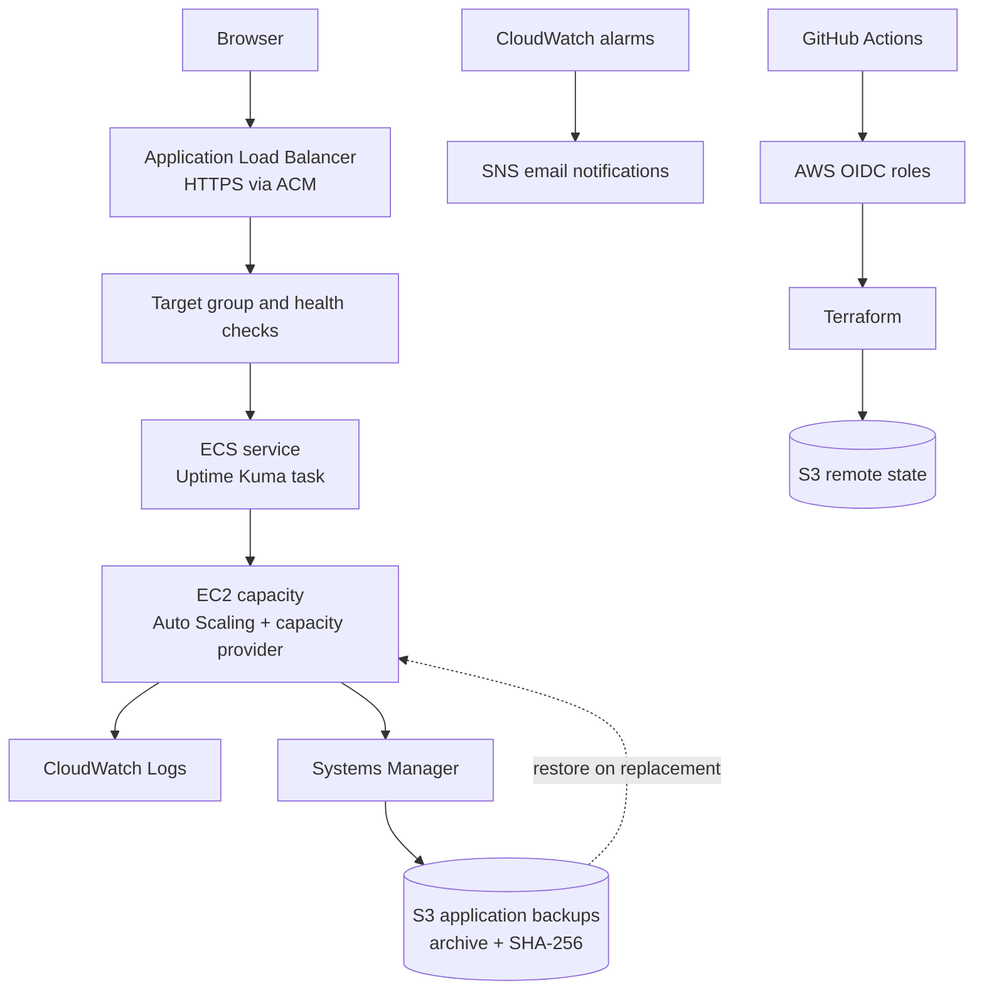

# Uptime Kuma on AWS — Terraform, ECS, CI/CD and Recovery

I deployed [Uptime Kuma](https://github.com/louislam/uptime-kuma) on **Amazon ECS using EC2 capacity**, with infrastructure provisioned by Terraform and deployments authenticated through GitHub Actions OIDC.

> **Portfolio project completed.** I demonstrated recovery after an EC2 replacement, restoring existing monitor configuration and history from an S3 backup whose SHA-256 checksum and SQLite integrity are validated before the ECS agent starts. The dashboard was usable within approximately **13 minutes 11 seconds of replacement launch** in the recorded drill; this is an observed upper bound, not a formally measured RTO. The application was last reported live on 20 October 2026. **The live demo may be available on request**; it is not intended to be continuously hosted.

## Results

- **Infrastructure as code:** Terraform-managed VPC, security groups, Application Load Balancer, ECS cluster/service, EC2 Auto Scaling Group and capacity provider.
- **Recovery demonstrated:** SQLite-consistent application backup to S3, SHA-256 verification, database-integrity check, and restoration of previous monitor data after EC2 replacement.
- **Deployment security:** GitHub Actions OIDC with short-lived AWS credentials, separate plan/apply roles, explicit apply confirmation, a protected deployment environment, and an encrypted short-retention Terraform plan artifact.
- **Operations and alerts:** CloudWatch logs and alarms, SNS email notifications, Systems Manager administration without public SSH, and a backup-freshness custom metric.

## Architecture



## What I verified

The items below summarize the recorded tests and closeout checks. They do not imply that the live application was re-probed during this documentation update.

### Recovery after instance replacement

1. A Systems Manager backup job created a SQLite-consistent snapshot and uploaded a timestamped archive and SHA-256 sidecar to S3.
2. Auto Scaling replaced the EC2 instance.
3. Startup validated the archive checksum and SQLite database integrity before starting the ECS agent.
4. Uptime Kuma returned with its previous monitor configuration and history, and the application target became healthy.

The recorded drill bounds dashboard recovery to about 13 minutes 11 seconds after replacement launch. The initial drill did not capture a precise termination-request-to-healthy-target duration, exact RPO/RTO, the S3 object version ID, the digest string, or direct SQLite integrity output. I therefore describe recovery as demonstrated, not as a measured service-level objective.

[Read the restore-drill record](docs/restore-drill.md).

### Deployment and infrastructure checks

- [Application deployment — workflow run #20](https://github.com/Pedro-Martins9/uptimekuma-aws-deployment/actions/runs/39461906090)
- [SNS/email alarm wiring — workflow run #21](https://github.com/Pedro-Martins9/uptimekuma-aws-deployment/actions/runs/39465845112)
- [Backup-freshness metric fix — workflow run #22](https://github.com/Pedro-Martins9/uptimekuma-aws-deployment/actions/runs/39473186374)
- [Terraform formatting and validation](https://github.com/Pedro-Martins9/uptimekuma-aws-deployment/actions/runs/39472903358)
- [Gitleaks secret-scanning workflow](https://github.com/Pedro-Martins9/uptimekuma-aws-deployment/actions/workflows/gitleaks.yml)

I also operationally verified the ECS dynamic host-port path on 20 October 2026: container port 3001 mapped to host port 32768, and the security-group rules allowed TCP 32768–65535. The observed kernel ephemeral range was 32768–60999, within the permitted range.

I confirmed that S3 backup tests and alarm/recovery email tests were working, and that the backup-freshness metric fix was deployed. These checks were confirmed during project closeout; they were not independently re-run as part of this README update.

## Key design decisions

- **ECS on EC2, not Fargate:** I wanted to learn capacity management alongside container orchestration. The trade-off is additional responsibility for the EC2 launch template, ECS agent, capacity provider and Auto Scaling.
- **One active task with local SQLite data:** I avoided multiple tasks maintaining independent local databases. A production-scale design would need a deliberately chosen persistence and availability model rather than simply increasing the desired count.
- **S3 recovery with integrity gates:** backups are useful only if they can be restored. Startup verifies the archive checksum and database integrity before allowing ECS to start.
- **Systems Manager instead of SSH:** instance administration and backup operations use AWS Systems Manager, without an inbound SSH rule.
- **OIDC instead of long-lived AWS keys:** GitHub Actions assumes AWS roles using short-lived credentials. The deployment workflow separates planning from a gated apply.

## Security and operating model

The ALB is designed to accept public IPv4 HTTP/HTTPS traffic; HTTP redirects to HTTPS using an ACM certificate in `eu-west-1`. ECS host ports are restricted to traffic from the ALB security group. Since the Uptime Kuma login page is internet-accessible while the demo is running, I use a strong, unique admin password and enable Uptime Kuma two-factor authentication before exposing the dashboard publicly.

The app was intended to be time-boxed to control cost. The hostname may be offline when the demo is not running; contact me to arrange a live walkthrough. The Terraform state and application-backup S3 buckets are managed separately from the application stack and can continue to incur storage charges.

I have not attached an independently audited Cost Explorer export, so I am **not publishing a project cost total**. A configured budget threshold is a notification setting, not proof that that amount was spent.

## Repository structure

```text
.github/workflows/
  gitleaks.yml
  terraform-deploy.yml
  terraform-validate.yml
docs/
  evidence-capture.md
  final-evidence.md
  oidc-setup.md
  portfolio-readiness.md
  restore-drill.md
terraform/
  bootstrap-state/  # One-time state-bucket bootstrap
  backup-infra/     # Persistent application-backup storage
  cost-controls/    # Optional persistent AWS budget alerts
  *.tf              # Main application infrastructure
```

## Run it in your own AWS account

This is a learning project, not a one-click deployment. Start with the [OIDC setup guide](docs/oidc-setup.md), review all Terraform configuration, and carefully inspect the full plan before applying. The backend uses partial configuration; configure the existing remote-state bucket via the `TFSTATE_BUCKET` secret for GitHub Actions or `-backend-config` locally. Set the expected AWS account ID through the documented variable and do not commit account-specific values.

The default hostname is `uptime.pedromartins9.me`; DNS is managed outside this Terraform root. The ACM certificate must already be issued in `eu-west-1` and cover the service hostname. The certificate lookup variable and apex/wildcard cases are documented in the deployment configuration and setup notes rather than in this overview.

When finished testing, review and destroy only the main application Terraform root. **Do not destroy the separate state, backup-infrastructure or cost-controls roots as part of routine application teardown.** Verify the resulting resource cleanup and review remaining billable storage.

## Further reading

- [OIDC setup and GitHub Actions permissions](docs/oidc-setup.md)
- [Backup and restore drill](docs/restore-drill.md)
- [Final evidence pack](docs/final-evidence.md)
- [Evidence capture guide](docs/evidence-capture.md)
- [Portfolio readiness and closeout notes](docs/portfolio-readiness.md)

## Technologies

AWS ECS on EC2, EC2 Auto Scaling, VPC, Application Load Balancer, ACM, IAM, Systems Manager, CloudWatch, SNS, S3, SQLite, Terraform, GitHub Actions, OIDC and Gitleaks.

## License

This project is licensed under the [Apache License 2.0](LICENSE). The license applies to this project's original work; third-party tools and dependencies remain subject to their own licenses.
